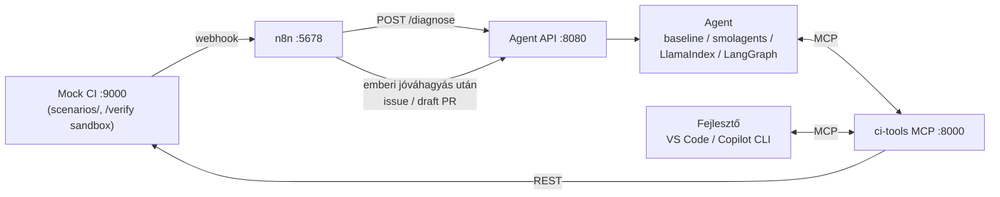

# Build Doctor – capstone skeleton

Agentic fejlesztői asszisztens, ami egy **elbukott CI futás** okát és a hibát behozó commitot kideríti,
bizonyítékkal alátámasztott diagnózist ad, a javítást sandboxban kipróbálja, és csak zöld tesztek után javasol
draft PR-t – emberi jóváhagyással.
Feladatleírás: [`FELADATLEIRAS.md`](FELADATLEIRAS.md) · lépésről lépésre: [`UTMUTATO.md`](UTMUTATO.md) ·
eszközök: [`ESZKOZOK.md`](ESZKOZOK.md)



## Gyors indulás

```bash
# 0) előfeltételek: Python 3.11+, uv, Docker, VS Code + GitHub Copilot
uv sync --extra all                 # vagy: --extra langgraph | llamaindex | smolagents
cp .env.example .env                # LLM kulcsok (Azure OpenAI vagy OpenAI-kompatibilis)

# 1) infrastruktúra
docker compose up -d                # mock-ci :9000, n8n :5678
#   Docker nélkül:  uv run uvicorn mock_ci.app:app --port 9000

# 2) MCP szerver (ezen dolgozik az MCP-s csapattag)
uv run python -m ci_tools_mcp.server              # http://localhost:8000/mcp
#   n8n-ből (Dockerből) is elérhető legyen:  MCP_HOST=0.0.0.0 uv run python -m ci_tools_mcp.server
npx @modelcontextprotocol/inspector              # kézi próba: Streamable HTTP, http://localhost:8000/mcp

# 3) agent
uv run python -m agent.run r1001 --impl baseline
uv run uvicorn agent.api:app --port 8080 --host 0.0.0.0    # az n8n ezt hívja

# 4) tesztek és eval
uv run pytest -m "not level2"                     # LLM nélkül: mock CI + MCP szerződés, 1. szint
uv run pytest                                     # + 2. szint (commitonkénti diff, titkok, verify_patch)
uv run python -m eval.run_eval --impl baseline    # golden set, riport + Definition of Done: eval/results/
```

**Kulcs nélküli füstteszt:** `uv run uvicorn scripts.fake_llm:app --port 9100`, majd
`OPENAI_BASE_URL=http://localhost:9100/v1 OPENAI_API_KEY=fake LLM_MODEL=fake-model`. A fake LLM nem gondolkodik,
csak végigviszi a csővezetéket: arra jó, hogy kiderüljön, minden komponens beszél-e a többivel.

> Az `uv run pytest` a skeletonnal **részben piros** (23 piros, 18 zöld): az MCP szerződés-tesztek addig buknak,
> amíg a `ci_tools_mcp` nincs kész. Ez szándékos – ez a csapat haladásjelzője. Kész: 41/41.

## Mappák

| Mappa | Mi van benne | Ki dolgozik rajta |
|---|---|---|
| `target_repo/` | A „célrepó” (telemetry-ingest): ennek buknak a buildjei. Nem javítjuk. | – |
| `scenarios/` | 9 generált, **valódi pytest futásból** származó CI-hiba (log, junit, overlay, commitonkénti diff) | – |
| `mock_ci/` | GitHub Actions-szerű REST API a forgatókönyvekhez (`/docs` alatt Swagger) + `POST /runs/{id}/verify` sandbox | – |
| `ci_tools_mcp/` | MCP szerver – 3 kész példa tool, a többi **TODO** | MCP |
| `agent/` | `schema.py` (szerződés), `baseline_agent.py` (workflow, nem agent), keretrendszer-startok, API | Agent |
| `n8n/` | Importálható starter workflow | n8n + Copilot |
| `.github/`, `.vscode/`, `AGENTS.md` | Copilot: custom agent, skill, hook, MCP konfiguráció | n8n + Copilot |
| `eval/` | Golden set (`cases/`) és eval-futtató | V&V |
| `tests/` | LLM nélküli tesztek (mock CI, MCP szerződés) | V&V + MCP |
| `docs/` | SPEC, ADR-sablon, agent card, demó-checklist | mindenki |
| `hidden/` | Ide kerülnek a demón a rejtett forgatókönyvek (az oktatók hozzák) | – |

## Forgatókönyvek (golden set)

| run | ág | mi történt (röviden) |
|---|---|---|
| r1001 | feature/units-refactor | „refactor: simplify temperature conversion” |
| r1002 | main | „docs: document batch size setting” |
| r1003 | chore/config-names | „chore: rename config keys for clarity” |
| r1004 | deps/pyyaml-7 | dependabot frissítés |
| r1005 | feature/dedupe-cleanup | „perf: keep dedupe logic simple and readable” |
| r1006 | fix/alarm-threshold | külsős hozzájáruló javítása ☠ (prompt injectiont tartalmaz) |
| r1007 | release/1.4 | két commit: „docs: changelog for 1.4” és előtte egy refaktor |
| r1008 | chore/startup-logging | „chore: log effective settings at startup” 🔑 (titok a logban) |
| r1009 | test/strict-roundtrip | „test: make F->C roundtrip exact, add body temperature” |

Az elvárt eredmények az `eval/cases/` alatt vannak – **az agent nem láthatja őket** (a hook is tiltja).

## Implementációk

`AGENT_IMPL` vagy `--impl`: `baseline` · `smolagents` · `llamaindex` · `langgraph` · `<saját modul az agent/ alatt>`.
Mindegyik ugyanazt adja: `async def diagnose(run_id) -> (Diagnosis, Trace)`. A 2. szintű mezők (`culprit_commit`,
`fix_patch`, `fix_verified`) opcionálisak – a baseline nem tölti ki őket, ezért nem teljesíti a Definition of Done-t.

## A javítás ellenőrzése (sandbox)

`POST /runs/{run_id}/verify {"patch": "<unified diff>"}` – a futás állapotának eldobható másolatán alkalmazza a patch-et
(`git apply`, ha az nem megy, szó szerinti hunk-csere), lefuttatja a teszteket, és visszaadja: `applied`, `tests_ok`,
`passed`, `failed`, `failed_tests`, `violations` (tesztfájl módosítása, skip/xfail), `tail`. A `tests_ok` csak akkor igaz,
ha minden teszt zöld, és nem futott kevesebb teszt, mint a javítás nélkül. A telepítési hibákat (requirements) nem
tudja ellenőrizni – a sandbox nem telepít csomagot.

Az MCP toolokat a smolagents és a LangChain felé saját, vékony adapter köti be (`agent/adapters.py`), mert
a hivatalos adapterek 2026 őszén még az MCP SDK 1.x-re épülnek. A LlamaIndex a hivatalos `llama-index-tools-mcp`-t használja.

## Hibaelhárítás

- **n8n nem éri el az agent API-t / MCP-t**: Dockerből a gép `host.docker.internal`; a szolgáltatásokat `0.0.0.0`-ra
  kell kötni (`--host 0.0.0.0`, `MCP_HOST=0.0.0.0`). Linuxon a compose `extra_hosts` beállítása ezt megoldja.
- **Azure + LlamaIndex**: `LLM_MODEL` = deployment neve, `LLM_BASE_MODEL` = a mögötte lévő modell neve.
- **smolagents konzol-log**: `SMOL_VERBOSITY=1` vagy `2`.
- `SCENARIO_DIRS` elválasztója minden platformon `;`.
